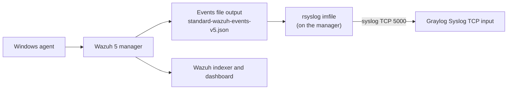

# Wazuh 5 to Graylog: Forward Manager Events with rsyslog

Send decoded Wazuh 5 events from the manager node to Graylog over Syslog TCP using rsyslog. No agents on the indexer, no Python.

## Key points (read first)

> From the Wazuh team (Slack, Wazuh 5.0.0-rc1):
>
> **The manager is responsible for decoding events. This is why you can forward decoded events from the manager.**
>
> **The indexer is responsible for matching rules and generating the findings. So the findings only exist on the indexer.**
>
> **It's not possible to forward the findings from the manager since they are never stored there.**

What this means:

| | Wazuh 4 | Wazuh 5 (RC) |
|---|---|---|
| Rule matching | Manager | Indexer |
| Alerts file on the manager (`alerts.json`) | Yes | No |
| Forward events from the manager | Yes | Yes (decoded events, this repo) |
| Forward alerts (findings) from the manager | Yes (`syslog_output`) | **Not possible** |
| Findings available at | Manager | Indexer only (`wazuh-findings-v5-*`) |


## What you get

- Full decoded Wazuh events in Graylog, with the original Windows or Sysmon event inside.
- Wazuh manager service logs (`wazuh-manager.log`, `api.log`, `cluster.log`) in Graylog.
- Disk-backed rsyslog queue, so events are kept if Graylog is briefly down.

## Tested on

- Wazuh 5.0.0-rc1, single node, Ubuntu with rsyslog 8.2312 and AppArmor
- Graylog 7.1 with a Syslog TCP input


Not tested: multi-node clusters, other distributions, other Graylog versions. Items marked **Verify** below are not confirmed.

## Requirements

- Wazuh 5 manager node with root access
- Graylog with a **Syslog TCP** input (note its port, for example 5069) reachable from the manager
- `rsyslog` and `acl` packages


## 1. How it works



Wazuh 5 has no alerts.json and no syslog_output. The manager can write its events to a JSON file once the optional file output is enabled. rsyslog tails that file and forwards each line to Graylog. Wazuh itself keeps working as before.

## 2. Values used in this guide

| Item | Value |
| --- | --- |
| Graylog server | 192.168.31.24 (Graylog 7.1.10) |
| Graylog input | Syslog TCP, title wazuh5-manager-syslog, bind 0.0.0.0, port 5069 |
| Source file on the manager | /var/wazuh-manager/logs/standard-wazuh-events-v5/standard-wazuh-events-v5.json |
| Output switch file | /var/wazuh-manager/etc/outputs/default/file-output-integrations.yml |
| rsyslog config | /etc/rsyslog.d/60-wazuh5-graylog.conf |

## 3. Step 1 - Create the Graylog input

1. Log in to Graylog and go to System, then Inputs.
2. In the Select input dropdown choose **Syslog TCP**, then click **Launch new input**.
3. Fill in: Title `wazuh5-manager-syslog`, Bind address `0.0.0.0`, Port `5000`. Use a port above 1024, because 514 needs root.
4. Save and wait until the state shows **RUNNING**. The port shown in the Inputs list is the real one, so check it.

## 4. Step 2 - Open the port and test from the manager

On the Graylog machine, only if ufw is active:

```bash
sudo ufw allow 5000/tcp
```

On the Wazuh manager:

```bash
nc -vz 192.168.31.24 5000
```

You should see a success or open message. If it times out, fix the firewall or the Graylog bind address before continuing.

## 5. Step 3 - Install rsyslog and acl on the manager

```bash
sudo apt update
sudo apt install -y rsyslog acl
systemctl is-active rsyslog
```

## 6. Step 4 - Turn on the Wazuh events file output

The file output is disabled by default. Source: a Wazuh engineer's answer in the Wazuh community Slack for 5.0 RC.

```bash
sudo nano /var/wazuh-manager/etc/outputs/default/file-output-integrations.yml
```

Set `enabled: true`, save, then restart the manager and confirm the file appears and grows:

```bash
sudo systemctl restart wazuh-manager
sleep 20
sudo ls -la /var/wazuh-manager/logs/standard-wazuh-events-v5/
sudo tail -n 1 /var/wazuh-manager/logs/standard-wazuh-events-v5/standard-wazuh-events-v5.json
```

The events use the new wazuh-events-v5 format (ECS-style JSON), not the old 4.x alerts.json format.

## 7. Step 5 - Let rsyslog read the file (permissions)

rsyslog runs as user syslog, and the Wazuh folders are owned by wazuh-manager with no access for others. Grant read access with ACLs:

```bash
sudo setfacl -m u:syslog:x /var/wazuh-manager /var/wazuh-manager/logs
sudo setfacl -R -m u:syslog:rX /var/wazuh-manager/logs/standard-wazuh-events-v5
sudo setfacl -d -m u:syslog:rX /var/wazuh-manager/logs/standard-wazuh-events-v5
sudo -u syslog head -c 200 /var/wazuh-manager/logs/standard-wazuh-events-v5/standard-wazuh-events-v5.json
```

The last command must print the start of a JSON line. The default ACL (the -d line) makes new files created by log rotation readable too.

## 8. Step 6 - Allow rsyslog through AppArmor

On Ubuntu, rsyslog has an AppArmor profile that only allows reading under /var/log. Even with correct file permissions, rsyslog logged Permission denied for the Wazuh file until this was added:

```bash
echo '/var/wazuh-manager/logs/standard-wazuh-events-v5/ r,
/var/wazuh-manager/logs/standard-wazuh-events-v5/** rk,
/var/wazuh-manager/logs/ r,
/var/wazuh-manager/ r,' | sudo tee -a /etc/apparmor.d/local/usr.sbin.rsyslogd
sudo apparmor_parser -r /etc/apparmor.d/usr.sbin.rsyslogd
```

To confirm AppArmor is the blocker on another machine, run `sudo journalctl -k | grep -i apparmor | tail`. DENIED lines for /var/wazuh-manager mean this step is needed.

## 9. Step 7 - Write the rsyslog forwarding config

```bash
sudo tee /etc/rsyslog.d/60-wazuh5-graylog.conf > /dev/null <<'EOF'
module(load="imfile")

input(type="imfile"
      File="/var/wazuh-manager/logs/standard-wazuh-events-v5/standard-wazuh-events-v5.json"
      Tag="wazuh-events:"
      Severity="info"
      Facility="local6"
      addMetadata="off")

local6.* action(type="omfwd"
      target="192.168.31.24"
      port="5000"
      protocol="tcp"
      template="RSYSLOG_SyslogProtocol23Format"
      action.resumeRetryCount="-1"
      queue.type="LinkedList"
      queue.size="10000"
      queue.filename="wazuh5_fwd"
      queue.saveOnShutdown="on")
EOF
```

The queue settings keep messages on disk and retry if Graylog is down.

## 10. Step 8 - Validate and restart

```bash
sudo rsyslogd -N1
sudo systemctl restart rsyslog
sudo journalctl -u rsyslog -n 15 --no-pager
sudo ss -tnp | grep 5069
```

Expected: the validation ends with End of config validation run, there is no Permission denied line in the journal, and ss shows an ESTABLISHED connection from rsyslogd to 192.168.31.24:5069.

## 11. Step 9 - Verify in Graylog

1. Generate an event, for example run `hostname` in PowerShell on the Windows agent.
2. In Graylog go to System, Inputs, and click **Received messages** on wazuh5-manager-syslog. You can also open Search with a query on the input id and a time range of the last 5 minutes.
3. You should see messages whose message field contains the whole event JSON (wazuh, agent, event.original and so on).
